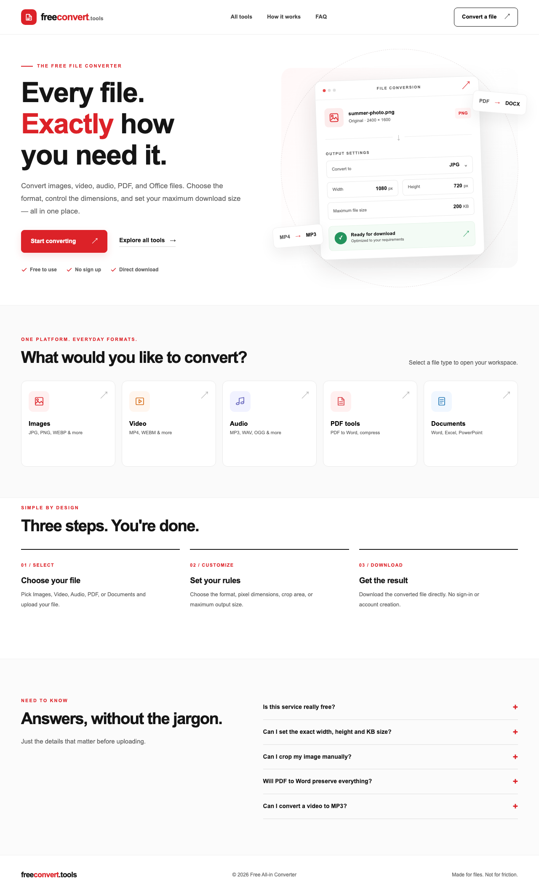

# Free All-in Converter

**Your file. Your format. Your size.** A no-login, mobile-friendly conversion website with a white, red and black interface.



Additional previews: [mobile homepage](docs/home-mobile.png) · [image conversion workspace](docs/image-workspace.png).

## What works in this release

- **Image**: JPG/JPEG, PNG, WEBP, GIF, BMP, TIFF inputs → JPG, PNG, WEBP, BMP, TIFF. Image preview, manual drag-to-crop (mapped to original pixel coordinates), optional width and height, aspect-ratio lock, fit / center-crop / pad / stretch, and optional file-size ceiling.
- **Video**: MP4, WEBM, MOV, MKV, AVI → MP4 or WEBM. Optional maximum width and output MB target.
- **Audio**: MP3, WAV, OGG, M4A, FLAC, AAC, WMA, and supported uploaded videos → MP3, M4A, OGG, or WAV. Optional compressed-audio size target. No downloading from streaming platforms.
- **PDF**: PDF → editable DOCX **text extraction** (no OCR or complex layout guarantees); PDF → compressed PDF.
- **Documents**: DOC, DOCX, PPT, PPTX, XLS, XLSX, ODT, ODP, ODS, RTF, TXT → PDF.
- **UX**: category-selection dialog, drag/drop and file picker, privacy note, live output summary, responsive design, clear errors, direct download, no account or database.

The brand phrase "All-in" describes a single destination for multiple file types; it **does not** promise that every possible source/target format pair is supported. The interface and API enforce the actual supported matrix.

## Architecture

```text
Browser (HTML/CSS/JS, no login)
    ├── Category selection dialog
    ├── File picker / image crop / live dimensions + KB / MB estimate
    └── POST /api/convert (multipart/form-data)
                    │
              FastAPI API
                    │
      Temp directory unique to each request
                    │
          ┌─────────┼──────────┬──────────────┐
       Pillow      FFmpeg   Ghostscript   LibreOffice
       images      AV        PDF compress   Office → PDF
                                   │
                           pypdf + python-docx
                           PDF text → DOCX
                    │
             Download file response
                    │
             Cleanup temp directory
```

Single-process FastAPI container. No user database, authentication, or long-term file storage. Free deployment is **limited** by CPU, memory, upload size (default 80 MB), conversion timeout, and service hosting terms. For public launch beyond a prototype, extend the built-in limiter with edge throttling, malware scanning, stronger resource isolation, monitoring and a conversion queue.

## Run locally

Requires Python 3.12+, FFmpeg/ffprobe, Ghostscript and LibreOffice for full feature support.

```sh
python -m venv .venv
source .venv/bin/activate
pip install -r requirements.txt
uvicorn app.main:app --reload
```

Browse `http://localhost:8000`. Image and PDF-to-Word conversion can run without FFmpeg / LibreOffice. Set `MAX_UPLOAD_MB=80` and `MAX_JOBS=1` for default limits.

### Docker (recommended)

```sh
docker build -t free-all-in-converter .
docker run --rm -p 10000:10000 -e PORT=10000 free-all-in-converter
```

Browse `http://localhost:10000`.

### Automated tests

```sh
pip install -r requirements-dev.txt
python -m pytest -q
```

Tests cover all core conversion routes, crop geometry, file-size limits, PDF→Word, Word→PDF and public UI landmarks. FFmpeg, Ghostscript and LibreOffice must be installed for the full test suite.

## Deploy for a public prototype

**Render single-service:** Push this project's root to a **new** GitHub repository, then in Render choose New > Blueprint, connect the repository and deploy the included `render.yaml` (or New > Web Service > Docker > Free). No database required. The site and API share one origin. Health route: `/health`. Render Free spins down after inactivity and has usage and resource limits; it should not be presented as production-grade hosting.

**Optional Firebase:** Firebase Hosting can host static HTML/CSS/JS; the Python/FFmpeg/LibreOffice backend must run separately (e.g., Render or Cloud Run). To split them, update the frontend API base URL, configure CORS for your exact frontend domain, and plan for compute costs/quotas. Firebase Spark alone cannot execute a Python media-conversion backend.

**Domain:** GitHub Student Developer Pack currently lists eligible 1-year offers through Namecheap (.me), Name.com (select extensions) and .TECH. Availability, eligibility, renewal pricing and domains vary. Point DNS at your host only after the site is deployed and verified.

See [DEPLOYMENT.md](DEPLOYMENT.md) and [CODEX_PROMPT.md](CODEX_PROMPT.md).

## API

- `GET /health` → uptime check
- `GET /api/capabilities` → supported categories/formats
- `POST /api/convert` multipart fields:
  - `file` (required)
  - `category`: `image | video | audio | pdf | document`
  - `output_format`: validated against category
  - `target_mb`: optional maximum size, fractional MB allowed (KB ÷ 1024)
  - `max_width`, `max_height`: optional pixel constraints
  - `resize_mode`: `contain | cover | pad | stretch` (image)
  - `crop_x`, `crop_y`, `crop_width`, `crop_height`: optional original-pixel crop rectangle, all four required if any are supplied (image)

Returns a binary file with `Content-Disposition: attachment`, or JSON error. Target size is treated as a **maximum, not guaranteed exact size**; impossible combinations result in 422 errors rather than silently changing a user's fixed dimensions.

## Privacy and limitations

Uploads are processed on the server in per-request temporary directories and removed after the response finishes. Keep uploads limited to non-sensitive documents on an untrusted public prototype. The converter does not fetch external URLs or download third-party music. For true public production, run conversion processes in further-isolated sandboxes and include malware scanning and abuse protection.

## Design

White canvas, #dc2228 accent red, near-black text; no neon AI design language, no account prompts, and clear progressive disclosure. Core conversion UI available via category cards and a starting dialog. Responsive layout is covered by the browser suite at 320, 390, 768, 1024 and 1440 px. See the QA report for completed runs.

## Audited release (10 November 2026)

See [QA.md](docs/QA.md) for actual verification results and [SECURITY.md](docs/SECURITY.md) for implemented safeguards and remaining public-production work. **No public deployment is recorded yet.** A Docker build or a localhost URL is not a Render deployment.

The release keeps the existing white/red/black UI and all five conversion categories. Improvements include keyboard-accessible dialogs and numeric crop editing, focus restoration, visible control focus, corrected contrast, dynamic upload limits, settings locked during conversion, exact 1 KB targets, safe errors, bounded requests and disposable conversion workers. Fonts use local system fallbacks; the browser makes no third-party requests.

Defaults: 80 MB uploads locally; the supplied Render Blueprint uses **40 MB**, one conversion, three active requests, a five-second queue wait, 16 megapixels for image input/output and a 240-second job deadline. Pixel fields allow 1–8192 individually, subject to the total pixel cap. Both PDF routes allow at most 80 pages. Maximum targets are not exact-size guarantees. Fit never enlarges an image; Cover, Pad and Stretch produce the specified canvas when both dimensions are supplied. GIF/animated inputs and multi-page TIFF use the first frame/page. Browser TIFF preview/crop support varies even though server conversion works. PDF compression returns the original bytes if recompression would enlarge the file. TXT input must be UTF-8.

For a repeatable full test run with native binaries:

```sh
docker build --target test -t converter:test .
docker run --rm --memory=512m --cpus=1 --pids-limit=128 converter:test
docker build --target production -t converter:production .
docker run --rm -p 127.0.0.1:10000:10000 -e RATE_LIMIT_PER_MINUTE=0 converter:production
# In another terminal (use host.docker.internal on Docker Desktop):
docker run --rm converter:test python scripts/smoke.py http://host.docker.internal:10000
docker run --rm --user root -v "$PWD/artifacts:/fixtures" converter:test python scripts/fixtures.py /fixtures/fixtures
npm ci
npx playwright install chromium firefox webkit
npm run test:browser
```

`RATE_LIMIT_PER_MINUTE=0` is only for repeated automated tests. Keep the default limit enabled on a public service. If native browser launch is unavailable, the same suite runs in `mcr.microsoft.com/playwright:v1.58.2-noble` with `BASE_URL=http://host.docker.internal:10000`. CI uses Linux and builds the full production image before testing.
